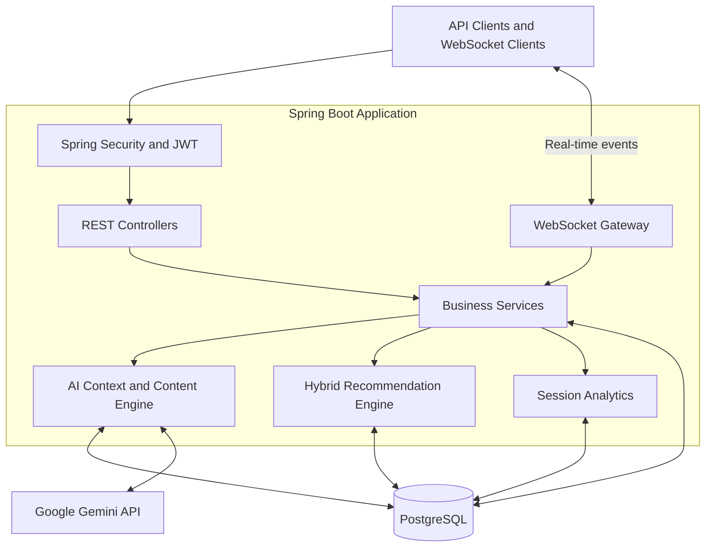

# 🎬 AI Watch Spaces

### Real-Time Social Viewing. Context-Aware AI. Personalized Recommendations.

**AI Watch Spaces** is a backend engineering project that brings together synchronized group viewing, real-time communication, timeline-grounded AI assistance, interactive content variations, and personalized recommendations in one system.

Instead of treating a watch party as just a room with chat, this project explores how a backend can coordinate playback state, understand contextual metadata, answer viewer questions, and personalize the viewing experience using recorded interactions.

<p align="center">
  
  
  
  
  
</p>

<p align="center">
  <a href="https://ai-watch-spaces.onrender.com">🌐 Live Backend</a> •
  <a href="https://github.com/rajujindam/ai-watch-spaces">💻 Source Code</a> •
  <a href="docs/architecture.md">🏗️ Architecture</a> •
  <a href="docs/api-reference.md">📖 API Reference</a>
</p>

---

## ✨ The Vision

Imagine watching a movie with friends in different locations. Everyone stays synchronized, viewers can chat in real time, and an AI co-pilot can answer questions using the title's timeline metadata. Interactive trivia, group voting on content variations, and personalized recommendations add another layer to the experience.

That is the engineering challenge behind AI Watch Spaces.

The project brings together several backend concerns that are often developed separately:

- Real-time state coordination
- Reactive request and event handling
- Authentication and resource-level authorization
- Retrieval-grounded AI interactions
- Collaborative and content-based recommendations
- Persistent analytics and event tracking
- Containerization and cloud deployment

**The focus is not just building endpoints—it is connecting multiple backend subsystems into one coherent application.**

## 🚀 Feature Highlights

### 🎥 1. Watch Spaces & Playback Coordination

Create a shared viewing room with a host, participants, room configuration, and a defined lifecycle.

- Create and retrieve Watch Spaces.
- Manage participant membership.
- Track scheduled, live, and ended room states.
- Maintain playback status and position.
- Broadcast playback updates through WebSockets.

### ⚡ 2. Real-Time Communication

A WebSocket gateway enables room-level communication without requiring clients to repeatedly poll REST endpoints.

- Participant presence events.
- Live chat messages.
- Playback update broadcasts.
- AI trivia events.
- Content variation and voting events.
- Persistent room-event recording for analytics.

### 🧠 3. Timeline-Grounded AI Co-Pilot

The AI component uses title timeline metadata to provide context-aware assistance rather than relying exclusively on general model knowledge.

- Retrieve relevant timeline events.
- Construct context for AI questions.
- Generate answers using a configured Google Gemini provider.
- Generate contextual trivia.
- Accept timeline metadata through validated JSON/YAML uploads.

The grounding approach is designed to keep answers connected to available title metadata. Its accuracy depends on the completeness and relevance of that metadata.

### 🗳️ 4. Interactive Content Variations

Give participants a way to vote on alternative content options associated with a viewing experience.

- Create and manage variation options.
- Record participant votes.
- Prevent duplicate voting by the same user within a voting round.
- Determine a winning option when voting closes.
- Broadcast variation-related events to connected clients.

### 🎯 5. Hybrid Recommendation Engine

The recommendation system combines two complementary approaches:

| Approach | Purpose |
|---|---|
| Content-based filtering | Uses the user's interaction history and genre preferences to score candidate titles. |
| Collaborative filtering | Uses overlap between users' interacted-title sets to identify potentially relevant titles. |
| Hybrid ranking | Combines normalized candidate scores using a 60% content-based and 40% collaborative weighting. |

The engine records viewing interactions, ratings, completion information, and watched duration. Recommendations are recalculated from current interaction data rather than requiring a model retraining pipeline for every new interaction.

### 📊 6. User Dashboard & Session Analytics

The dashboard combines several backend capabilities into a single response:

- Recently watched titles.
- Upcoming scheduled Watch Spaces.
- Active rooms available for quick rejoining.
- Personalized recommendations.

Session analytics summarize recorded activity, including duration, peak concurrent participants, AI questions, trivia cards, and chat messages.

### 🔐 7. Security & Access Control

Security is enforced at the backend rather than relying on frontend visibility.

- JWT-based registration and login.
- Protected REST endpoints.
- Role-based authorization for administrative operations.
- Host and participant authorization checks.
- Request validation and structured error handling.
- Environment-based secret configuration.

### 📦 8. Administrative Metadata Ingestion

Timeline metadata can be uploaded using JSON or YAML. The upload workflow parses and validates the metadata before persisting timeline events, helping prevent malformed or unsupported content from entering the system.

---

## 🏗️ System Architecture

The application separates HTTP APIs, real-time communication, business services, AI integration, and persistent storage.



### Architectural responsibilities

| Component | Responsibility |
|---|---|
| REST API | Authentication, resource management, metadata ingestion, recommendations and dashboard access. |
| WebSocket gateway | Room connections, chat, presence and real-time event delivery. |
| Security layer | JWT validation, role checks and request authorization. |
| AI content engine | Timeline retrieval, context construction and AI-generated content. |
| Recommendation engine | Genre preference scoring, collaborative similarity and hybrid ranking. |
| Analytics services | Aggregate persisted room-event records into session metrics. |
| PostgreSQL | Persist application entities, interactions, timeline events and analytics events. |

See [Architecture Overview](docs/architecture.md) for detailed component and data-flow documentation.

## 🛠️ Technology Stack

| Technology | Role |
|---|---|
| Java 21 | Primary programming language |
| Spring Boot | Application framework |
| Spring WebFlux | Reactive web endpoints and WebSocket integration |
| Spring Security | Authentication and authorization |
| OAuth2 Resource Server / JWT | Bearer-token validation |
| Spring Data JPA & Hibernate | Relational persistence |
| PostgreSQL | Application database |
| Google Gemini API | AI-generated answers and trivia |
| Maven | Build and dependency management |
| JUnit & Mockito | Automated testing |
| Docker & Docker Compose | Containerization and local deployment |
| Render | Hosted application and managed PostgreSQL |

## 🔌 API Preview

The REST API uses the `/api/v1` prefix. Protected endpoints require a bearer token.

```http
Authorization: Bearer <access-token>
```

| Method | Endpoint | Purpose |
|---|---|---|
| `POST` | `/api/v1/auth/register` | Register a user |
| `POST` | `/api/v1/auth/login` | Authenticate and obtain a token |
| `POST` | `/api/v1/titles` | Create a title |
| `POST` | `/api/v1/watch-spaces` | Create a Watch Space |
| `GET` | `/api/v1/watch-spaces/{id}` | Retrieve a Watch Space |
| `POST` | `/api/v1/watch-spaces/{id}/participants` | Join a Watch Space |
| `GET` | `/api/v1/watch-spaces/{id}/participants` | List room participants |
| `POST` | `/api/v1/interactions` | Record a viewing interaction |
| `GET` | `/api/v1/recommendations` | Retrieve personalized recommendations |

Additional endpoints support playback, AI Q&A, variations, analytics, dashboards, and administrative timeline metadata. See the complete API reference for the verified route inventory, request schemas, response examples, and WebSocket events.

### Example: Create a Watch Space

```http
POST /api/v1/watch-spaces
Content-Type: application/json
Authorization: Bearer <access-token>
```

```json
{
  "name": "Friday Movie Night",
  "titleId": 1,
  "maxParticipants": 5,
  "aiVerbosity": "NORMAL",
  "votingEnabled": true
}
```

The response includes the room identifier, host, title, configuration, lifecycle status, and timestamps.

### WebSocket Gateway

The gateway is configured at:

```text
/ws/watch-spaces/**
```

The gateway handles authenticated room connections and event-based communication. Consult the API reference for the actual message envelope and supported event types.

## 🧪 Testing & Quality

The repository includes automated tests for application integration, AI content logic, and recommendation behavior.

Run the test suite from the project root:

```bash
mvn test
```

Tests that require environment variables must be run with the appropriate configuration. Test output should be used as the source of truth for pass/fail counts.

Further validation areas include:

- Playback state transitions.
- AI retrieval and grounding behavior.
- Authorization and role enforcement.
- Recommendation updates after new interactions.
- Multi-client WebSocket behavior.
- Reconnect handling and event consistency.

Performance figures should be added only after running repeatable load tests and recording actual measurements.

## ⚙️ Getting Started

### Prerequisites

Install:

- JDK 21
- Maven
- PostgreSQL, or Docker Desktop
- A Google Gemini API key for real AI-provider functionality

### 1. Clone the repository

```bash
git clone https://github.com/YOUR_GITHUB_USERNAME/ai-watch-spaces.git
cd ai-watch-spaces
```

Replace `YOUR_GITHUB_USERNAME` with the actual GitHub account that owns the repository.

### 2. Configure environment variables

Configure the following variables in your IDE, shell, or local `.env` file:

```dotenv
DB_URL=jdbc:postgresql://localhost:5432/ai_watch_spaces
DB_USERNAME=postgres
DB_PASSWORD=replace_with_your_database_password
JWT_SECRET=replace_with_a_strong_secret
GOOGLE_API_KEY=replace_with_your_gemini_api_key
SPRING_PROFILES_ACTIVE=gemini
PORT=8080
```

Use a strong JWT secret and keep the `.env` file out of version control. Never use the example placeholder values as production credentials.

Create the `ai_watch_spaces` PostgreSQL database before starting the application locally.

### 3. Start the application

Configure the environment variables and run:

```bash
mvn spring-boot:run
```

The default local HTTP address is:

```text
http://localhost:8080
```

### 4. Run with Docker Compose

With Docker Desktop running and the required environment variables configured:

```bash
docker compose up --build -d
```

Inspect logs:

```bash
docker compose logs -f app
```

Stop the containers:

```bash
docker compose down
```

The Compose setup uses a PostgreSQL volume for persistent database storage.

## ☁️ Live Deployment

The backend is deployed on Render, with a managed PostgreSQL database.

**Live service:** [https://ai-watch-spaces.onrender.com](https://ai-watch-spaces.onrender.com)

The service requires authentication for protected endpoints. The public service URL is not a substitute for an interactive frontend; this project focuses on backend functionality exercised through HTTP and WebSocket clients.

Production secrets and database credentials are configured through environment variables rather than committed to source control.

## 📚 Documentation

| Document | Description |
|---|---|
| [Architecture Overview](docs/architecture.md) | Components, responsibilities and data flow |
| [API Reference](docs/api-reference.md) | REST endpoints, request/response examples and WebSocket messages |
| [Database Schema](docs/database-schema.md) | Entities, tables, indexes and relationships |
| [Known Limitations](docs/known-limitations.md) | Current constraints, trade-offs and future improvements |

These documents should reflect the actual shipped implementation and be completed before the project is presented as fully documented.

## 🗺️ Engineering Roadmap

Potential next steps for evolving the system include:

- More comprehensive multi-client playback synchronization and drift measurements.
- Robust WebSocket reconnect and session-resumption behavior.
- Explicit source references in AI answers.
- More advanced recommendation evaluation and larger interaction datasets.
- Observability with structured logs, correlation IDs, and latency metrics.
- Reproducible load testing and performance reporting.
- Database migration tooling and production-grade deployment hardening.

## 💡 What This Project Demonstrates

AI Watch Spaces brings together several areas of backend engineering in one codebase:

- API design and validation.
- Authentication and resource-level authorization.
- Reactive request handling and real-time messaging.
- Relational data modeling and persistence.
- AI context retrieval and provider integration.
- Recommendation algorithms and interaction data.
- Event-based analytics.
- Automated testing, containerization and cloud deployment.

The result is a backend-focused engineering project designed to demonstrate how multiple subsystems can work together to support an AI-assisted, real-time social viewing experience.

---

<p align="center">
  <strong>Built with Java, Spring Boot, PostgreSQL, WebSockets, and AI.</strong>
  <br/>
  <sub>Designed to explore the intersection of real-time systems, intelligent content, and backend engineering.</sub>
</p>
