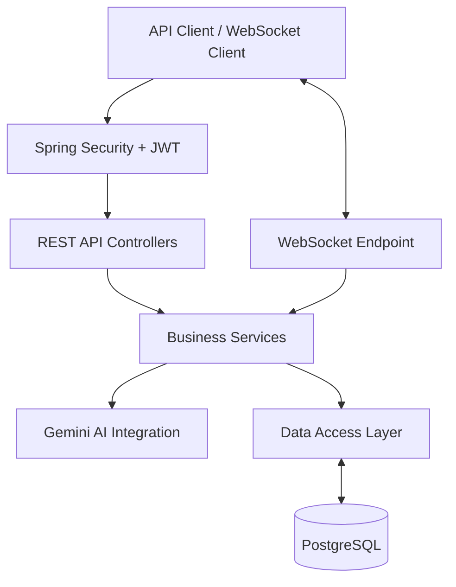

<div align="center">

# 🎬 AI Watch Spaces

### Real-Time Social Viewing · WebSocket Communication · AI-Powered Assistance

A backend-focused project that brings together watch spaces, secure APIs, real-time events, and AI-powered interactions using Java and Spring Boot.

<p>
  <a href="https://ai-watch-spaces.onrender.com"></a>
  <a href="https://ai-watch-spaces.onrender.com/swagger-ui/index.html"></a>
  
  
  
</p>

<p>
  <a href="https://github.com/rajujindam/ai-watch-spaces">Source Code</a> ·
  <a href="https://ai-watch-spaces.onrender.com/swagger-ui/index.html">Explore API</a>
</p>

</div>

---

## 📌 About the Project

**AI Watch Spaces** is a backend engineering project for a Netflix-style social watch-party experience. It explores how a backend can manage watch spaces, protect APIs, persist application data, communicate with connected clients in real time, and integrate an AI provider.

The project is designed to be explored and tested through REST APIs, Swagger UI, WebSocket clients, and automated tests. It does not require a dedicated frontend to exercise its backend functionality.

> This is an independent project and is not affiliated with or endorsed by Netflix.

## ✨ Implemented Capabilities

- **Watch Space APIs** — create, retrieve, and manage watch spaces through backend endpoints.
- **Authentication and authorization** — secure protected endpoints with Spring Security and JWT.
- **PostgreSQL persistence** — store application data in a relational database.
- **Real-time communication** — WebSocket support for watch-space events.
- **Gemini AI integration** — AI-powered functionality through a configured Gemini provider.
- **API documentation** — inspect and call documented endpoints through Swagger UI.
- **Validation and error handling** — validate incoming requests and return application errors consistently.
- **Automated tests** — run the project test suite with Maven.
- **Cloud deployment** — deployed backend service on Render.

The capabilities above have been exercised as part of the project's current verification: public and authenticated endpoints, authentication edge cases, watch-space CRUD and persistence, WebSocket communication, AI integration/error handling, and automated tests.

## 🔗 Live Links

| Resource | Link |
|---|---|
| Live backend | [ai-watch-spaces.onrender.com](https://ai-watch-spaces.onrender.com) |
| Swagger UI | [Open API documentation](https://ai-watch-spaces.onrender.com/swagger-ui/index.html) |
| GitHub repository | [rajujindam/ai-watch-spaces](https://github.com/rajujindam/ai-watch-spaces) |

Use Swagger UI to inspect the available routes, request schemas, responses, and authentication requirements. For protected endpoints, obtain a JWT through the application's authentication flow and authorize requests with a Bearer token.

> Note: the Render service may take time to respond after an idle period depending on its hosting configuration.

## 🧰 Technology Stack

| Technology | Purpose |
|---|---|
| Java 21 | Main programming language |
| Spring Boot | Application framework |
| Spring WebFlux | Reactive web stack |
| Spring Security | Authentication and authorization |
| JWT / Bearer tokens | Token-based access to protected APIs |
| Spring Data JPA / Hibernate | ORM and relational persistence |
| PostgreSQL | Database |
| Google Gemini API | AI provider integration |
| Maven | Build and dependency management |
| Swagger / OpenAPI | Interactive API documentation |
| JUnit / Mockito | Automated testing |
| Docker | Containerization support |
| Render | Cloud hosting |

## 🏗️ High-Level Architecture



### Main responsibilities

- **Security:** validates JWTs and protects endpoints.
- **REST APIs:** exposes application operations to API clients.
- **WebSocket layer:** supports real-time client communication.
- **Service layer:** contains application logic.
- **AI integration:** communicates with the configured Gemini provider.
- **Persistence layer:** stores and retrieves application data through PostgreSQL.

This is a high-level view; the exact flow depends on the endpoint and feature being used.

## 🔐 Authentication

Protected endpoints expect a Bearer token:

```http
Authorization: Bearer <your-access-token>
```

Typical workflow:

1. Register or log in through the authentication endpoints.
2. Copy the access token returned by the API.
3. In Swagger UI, select **Authorize** and enter the token using the format expected by the configured Bearer scheme.
4. Call a protected endpoint.

The application has been tested with public and authenticated endpoints, including authentication edge cases.

## 🧪 Testing

Run the test suite from the project root:

```bash
mvn test
```

The project's test configuration supports running the general test suite without requiring a live Gemini API key when the test AI provider configuration is active. Tests that explicitly use the real provider may require valid credentials.

Useful manual verification areas:

- Public endpoint access
- JWT-protected endpoint access and rejection of invalid credentials
- Watch-space CRUD and database persistence
- WebSocket communication
- Gemini integration and error handling
- Automated test execution

## ⚙️ Run Locally

### Prerequisites

- JDK 21
- Maven
- PostgreSQL, with a local database created for the application
- A Gemini API key for real AI-provider functionality

### 1. Clone the repository

```bash
git clone https://github.com/rajujindam/ai-watch-spaces.git
cd ai-watch-spaces
```

### 2. Configure environment variables

The application reads database and JWT settings from environment variables. Configure the variables used by your local application configuration:

```dotenv
DB_URL=jdbc:postgresql://localhost:5432/ai_watch_spaces
DB_USERNAME=postgres
DB_PASSWORD=your_local_database_password
JWT_SECRET=replace_with_a_strong_secret
```

For the real Gemini provider, configure the API-key variable expected by that provider's implementation (for example, `GOOGLE_API_KEY` if that is the name used in your code).

Create the `ai_watch_spaces` database before starting the application. Check your configuration and provider class for the exact AI key name and active Spring profile.

**Security:** never commit real passwords, JWT secrets, API keys, or production connection strings to GitHub.

### 3. Start the application

```bash
mvn spring-boot:run
```

Open Swagger UI locally at:

```text
http://localhost:8080/swagger-ui/index.html
```

The local port may differ if you override the `PORT` setting.

## 🐳 Docker

Docker support is part of the project's technology stack. To run the containerized setup, use the repository's Docker configuration and ensure the required environment variables and database connection are configured.

If a Compose file is present in the current branch, start it with:

```bash
docker compose up --build
```

Stop the Compose stack with:

```bash
docker compose down
```

## ☁️ Deployment

The backend is deployed on **Render** and connected to a managed PostgreSQL database.

For a deployment of your own:

1. Connect the repository to your hosting provider.
2. Configure the database connection, JWT secret, and AI provider credentials.
3. Set the appropriate build and start commands.
4. Deploy the service.
5. Verify the public API, protected endpoints, database persistence, WebSocket behavior, and AI functionality.

Production credentials should be set through the hosting provider's environment-variable settings, not stored in source code.

## 🛣️ Possible Next Improvements

Potential areas to develop further as the project evolves:

- Add CI automation for builds and tests.
- Expand structured logging and production monitoring.
- Add repeatable load tests and publish measured results.
- Strengthen WebSocket reconnect and session-recovery scenarios.
- Review production database migration and backup practices.
- Add more API examples and screenshots to the repository documentation.

## 💡 What This Project Demonstrates

AI Watch Spaces brings several backend engineering concerns together in one application:

- REST API design and request validation
- JWT-based authentication and authorization
- Relational data modeling and persistence
- WebSocket-based real-time communication
- Integration with an external AI provider
- Automated testing and test isolation
- API documentation and cloud deployment

---

<div align="center">

**Built with Java · Spring Boot · PostgreSQL · WebSockets · Gemini AI**

*An evolving backend engineering project focused on real-time systems and AI-assisted experiences.*

</div>
