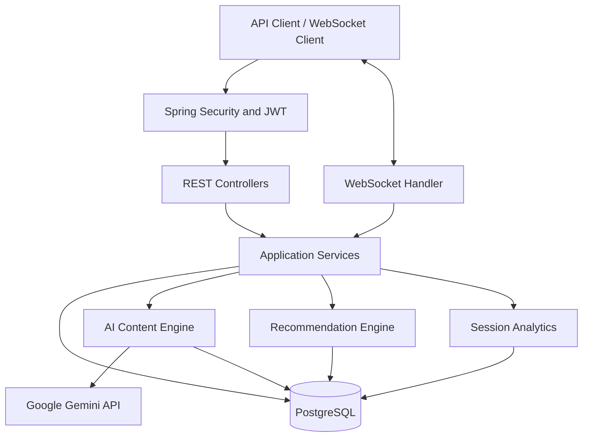

# System Architecture — AI Watch Spaces

## 1. Overview

AI Watch Spaces is a backend-only, real-time social viewing platform built with Java and Spring Boot. It enables users to participate in synchronized watch sessions, exchange live messages, interact with AI-generated content, vote on narrative variations, and receive personalized title recommendations.

The system exposes REST APIs for resource management and uses WebSockets for real-time room communication. PostgreSQL provides persistent storage for users, titles, watch spaces, timeline metadata, interactions, recommendation inputs, and session event logs.

## 2. Technology Stack

| Technology | Responsibility |
|---|---|
| Java 21 | Primary programming language |
| Spring Boot | Application configuration and dependency management |
| Spring WebFlux | Reactive HTTP and WebSocket handling |
| Spring Data JPA / Hibernate | Relational persistence |
| PostgreSQL | Persistent application data |
| Spring Security | Request authorization and access control |
| JWT | Stateless authentication |
| Google Gemini | AI-generated contextual answers and trivia |
| Maven | Dependency and build management |
| Docker | Containerized application deployment |
| JUnit and Mockito | Automated testing |

## 3. High-Level Architecture

The REST API layer handles request-response operations. The WebSocket layer supports bidirectional communication within watch spaces. Application services implement business rules, while PostgreSQL stores persistent application state and event history.

## 4. Major Components

### 4.1 Authentication and Authorization

Spring Security protects application endpoints using JWT bearer tokens.

- Registration and login endpoints are publicly accessible.
- Authenticated endpoints require a valid JWT.
- The authenticated user's identifier is obtained from the token rather than trusted from arbitrary request input.
- Administrative endpoints under `/api/v1/admin/**` require the `ADMIN` role.
- Resource-level checks protect watch-space operations from unauthorized access.

### 4.2 Watch Space Management

Watch spaces represent shared viewing sessions.

The lifecycle uses three statuses:

- `SCHEDULED` — the room has been created but has not started.
- `LIVE` — the viewing session is active.
- `ENDED` — the host has ended the session.

The backend supports room creation, retrieval, participant management, host-controlled lifecycle operations, and membership validation.

### 4.3 Real-Time Communication

The WebSocket endpoint is:

`/ws/watch-spaces/**`

The WebSocket handler manages connections through a room manager and processes supported room events, including chat messages, playback updates, presence changes, trivia, and narrative-variation interactions.

Room events are broadcast to connected participants. Persistent session events are recorded for analytics.

### 4.4 Playback State Management

Playback state tracks whether a session is playing or paused, the playback position, the associated watch space, the last update time, and the user responsible for the update.

Starting playback transitions a scheduled watch space to `LIVE`.

The playback state machine centralizes state transitions so that playback operations follow consistent application rules.

### 4.5 AI Contextual Assistance

The AI subsystem combines timeline metadata, context-building logic, content generation, and a provider abstraction.

The context-building layer retrieves relevant timeline events for a title. The content engine uses this context to construct grounded prompts for AI-generated answers and trivia.

The Gemini provider connects the application to Google's Gemini API. A test provider allows application tests to run without requiring a live AI response.

### 4.6 Narrative Variation and Voting

The variation subsystem manages available narrative options and voting within a watch space.

It supports opening a voting round, accepting participant votes, enforcing one vote per user for a round, and selecting a winning variation when voting closes.

The selected variation can be communicated to room participants through WebSocket events.

### 4.7 Personalized Recommendation Engine

The recommendation engine combines two approaches:

**Content-based recommendations**

Uses a user's interaction history, ratings, completion information, and title genres to estimate genre preferences and score candidate titles.

**Collaborative recommendations**

Compares users' interacted-title sets using Jaccard similarity and uses similar users' activity to generate candidate recommendations.

**Hybrid ranking**

Combines normalized content-based and collaborative scores, using a 60% content-based and 40% collaborative weighting in the current implementation.

Recommendations are calculated from current interaction data, so new interactions can affect results without requiring a separate model-training deployment.

### 4.8 Session Analytics

Session analytics are derived from persistent watch-space event logs.

The current analytics response includes:

- Session duration based on the recorded event interval.
- Peak concurrent participants.
- Number of AI questions.
- Number of trivia cards served.
- Number of chat messages.

The event log provides an auditable basis for calculating these metrics.

### 4.9 User Dashboard

The dashboard aggregates data from existing application services and repositories to provide:

- Recently watched titles.
- Upcoming scheduled watch spaces hosted by the user.
- Active watch spaces available for quick rejoining.
- Personalized recommendations.

### 4.10 Administrative Timeline Metadata Upload

Administrators can upload timeline metadata in JSON or YAML format.

The upload service parses the file, validates its structure and supported event types, checks the associated title and timeline timestamps, and persists valid timeline events.

Malformed files and unsupported metadata produce validation errors instead of being silently accepted.

## 5. Data Persistence

PostgreSQL stores the main application entities and their relationships. Major data groups include:

- Users and authentication-related information.
- Titles and genre associations.
- Watch spaces and participants.
- Timeline events stored with JSON payloads.
- Narrative variation options.
- User interactions used by the recommendation engine.
- Persistent watch-space event logs used by analytics.

The `interactions` table stores user and title identifiers, watched duration, completion status, optional rating, and creation time.

Timeline and event payloads use PostgreSQL JSONB where structured metadata is required.

## 6. Request and Event Flows

### REST request flow

1. A client sends an HTTP request with a JWT when authentication is required.
2. Spring Security validates the token and applies access-control rules.
3. The controller validates the request and delegates to the application service.
4. The service applies business rules and accesses the repository layer.
5. The API returns the appropriate response or error.

### AI question flow

1. An authenticated client submits a question for a watch space.
2. The AI service obtains relevant timeline context.
3. The content engine prepares a grounded prompt.
4. The configured AI provider generates the response.
5. The response is returned to the client, and the question is recorded for analytics.

### Recommendation flow

1. The service retrieves the user's interaction history.
2. Genre preferences are calculated for content-based scoring.
3. Similar users and candidate titles are evaluated for collaborative scoring.
4. Candidate scores are normalized and combined.
5. Already-interacted titles are excluded, and the highest-ranked candidates are returned.

### Session analytics flow

1. Room activity and supported application actions produce persistent events.
2. Events are stored with their watch-space identifier and timestamp.
3. The analytics service reads the event history and derives session metrics.
4. The analytics API returns the calculated values.

## 7. Deployment Architecture

The application is packaged as a Docker image and deployed as a Render web service. PostgreSQL runs as a managed Render database.

Configuration is supplied through environment variables rather than committed secrets. The deployment uses the database's internal connection address when the application and database share the same Render environment.

Important configuration variables include:

- `DB_URL`
- `DB_USERNAME`
- `DB_PASSWORD`
- `JWT_SECRET`
- `GOOGLE_API_KEY`
- `SPRING_PROFILES_ACTIVE`
- `PORT`

Local development can use Docker Compose to run the application and PostgreSQL together.

## 8. Testing Strategy

The project uses automated tests and API-level verification to validate important behavior.

The test suite includes coverage for AI content-engine behavior, application context startup, recommendation updates, recommendation evaluation, and WebSocket handling.

Manual API verification has also been used to check authentication, role restrictions, watch-space creation, participant management, and deployed endpoints.

Additional integration and load tests should be documented with measured results when completed. Do not interpret successful compilation or a passing unit test as proof of production-scale performance.

## 9. Current Limitations and Future Improvements

Potential improvements include:

- Stronger playback synchronization and drift correction across multiple clients.
- More robust handling of reconnects and multiple simultaneous connections for the same user.
- Explicit source metadata in AI responses to make contextual grounding easier to inspect.
- Database migrations instead of relying solely on automatic schema updates.
- Expanded integration, concurrency, and load testing.
- Improved observability through structured logging, correlation identifiers, and health monitoring.

These items should be considered separately from features already implemented and verified.

## 10. Design Principles

The project follows these principles:

- Separate HTTP request handling from application business logic.
- Validate input at API boundaries and enforce authorization at the service/resource level.
- Use persistent event records for auditable analytics.
- Keep AI-provider integration behind a dedicated abstraction.
- Derive recommendations from interaction data so results can update dynamically.
- Use automated tests and API-level evidence to verify functionality.
- Keep credentials and deployment configuration outside version control.
