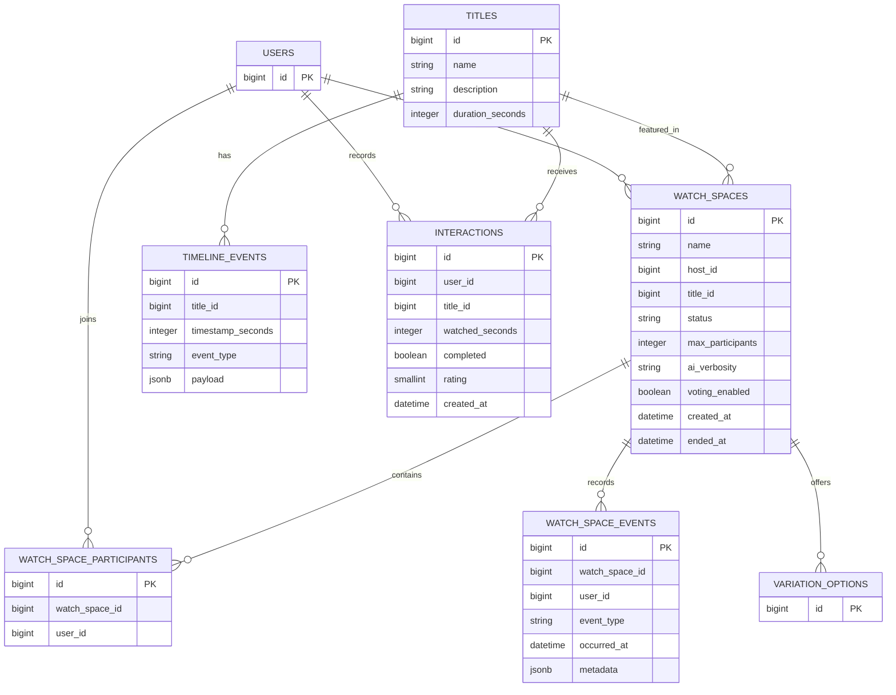

# Database Schema — AI Watch Spaces

## 1. Overview

AI Watch Spaces uses PostgreSQL for persistent application data. The database supports user authentication, title metadata, watch-space participation, timeline events, narrative variations, recommendations, and session analytics.

Hibernate/JPA manages entity persistence. Structured timeline and event metadata use PostgreSQL JSONB where appropriate.

> **Schema note:** This document describes the application's main entities and known fields. Exact foreign-key constraints, join-table names, and column definitions should be verified against the entity mappings and the deployed database schema.

## 2. Entity Relationship Overview

The diagram is conceptual. It shows the primary relationships and selected fields rather than every column in every entity.

## 3. Core Entities

### 3.1 User

Represents an authenticated application user.

User identifiers are used by authentication, watch-space ownership, participant membership, and title interaction records. Authorization also uses the user's role, including the `ADMIN` role for administrative endpoints.

Consult the user entity for the exact stored authentication and profile fields.

### 3.2 Title

Represents a title available for a watch session.

Known fields include:

| Field | Purpose |
|---|---|
| `id` | Primary identifier |
| `name` | Title name |
| `description` | Title description |
| `durationSeconds` | Runtime in seconds |
| `genres` | Genre associations used for recommendation scoring |

Genres are stored through a JPA element collection in the `title_genres` table.

### 3.3 WatchSpace

Represents a shared viewing room.

| Field | Purpose |
|---|---|
| `id` | Primary identifier |
| `name` | Room name |
| `hostId` | Identifier of the room host |
| `titleId` | Associated title identifier |
| `status` | `SCHEDULED`, `LIVE`, or `ENDED` |
| `maxParticipants` | Maximum participant count |
| `aiVerbosity` | AI response verbosity setting |
| `votingEnabled` | Whether voting is enabled |
| `createdAt` | Room creation time |
| `endedAt` | Time the room was ended, when applicable |

The host and title identifiers associate a room with its owner and the content being watched.

### 3.4 WatchSpaceParticipant

Represents membership in a watch space.

The participant record associates a user identifier with a watch-space identifier. The service prevents duplicate participation and checks membership when enforcing access to protected room operations.

### 3.5 TimelineEvent

Stores contextual events associated with a title and playback timestamp.

| Field | Purpose |
|---|---|
| `id` | Primary identifier |
| `titleId` | Associated title |
| `timestampSeconds` | Position in the title |
| `eventType` | Type of timeline event |
| `payload` | Structured event data stored as JSONB |

Supported metadata types include `trivia`, `character`, `variation_point`, and `glossary`.

An index on the title identifier and timeline timestamp supports retrieval of events within a playback range.

Timeline metadata provides context for AI-assisted questions and trivia.

### 3.6 Interaction

Records a user's interaction with a title. This table supplies input to the recommendation engine.

| Field | Type | Purpose |
|---|---|---|
| `id` | `Long` | Primary identifier |
| `userId` | `Long` | User who interacted with the title |
| `titleId` | `Long` | Associated title |
| `watchedSeconds` | `Integer` | Recorded viewing duration |
| `completed` | `Boolean` | Whether viewing was completed |
| `rating` | `Integer` | Optional rating from 1 to 5 |
| `createdAt` | `Instant` | Interaction creation time |

The application validates watched duration against the title runtime and validates ratings when supplied.

The recommendation engine uses these records to estimate genre preferences and identify similar users.

### 3.7 WatchSpaceEvent

Provides a persistent event log for room activity and analytics.

| Field | Purpose |
|---|---|
| `id` | Primary identifier |
| `watchSpaceId` | Associated watch space |
| `userId` | Associated user, when applicable |
| `eventType` | Type of recorded activity |
| `occurredAt` | Event timestamp |
| `metadata` | Optional structured event information stored as JSONB |

Examples of recorded event types include participant joins and departures, AI questions, trivia delivery, and chat messages.

Indexes support queries by watch space and event timestamp, as well as event type.

Session analytics derive counts and concurrency information from this event history.

### 3.8 VariationOption

Represents an available narrative variation associated with the variation feature.

Variation options support voting rounds and the selection of a winning narrative option. Consult the entity and repository mappings for the exact columns and relationships.

## 4. JSONB Storage

The application uses JSONB for structured metadata where event payloads may vary by event type.

Benefits include:

- Storing structured event-specific fields without requiring a separate table for every payload shape.
- Supporting timeline metadata for AI context retrieval.
- Recording additional event metadata for future analytics.

JSONB payloads still require application-level validation to prevent unsupported or malformed data from being persisted.

## 5. Recommendation Data Flow

The recommendation engine combines interaction history, title genres, and activity from other users.

1. Interactions are stored in the `interactions` table.
2. Ratings and completion information contribute to genre-preference scoring.
3. Content-based recommendations score titles using those preferences.
4. Collaborative recommendations compare interacted-title sets across users.
5. The hybrid service combines normalized scores and ranks candidate titles.
6. Titles already interacted with by the current user are excluded.

The current implementation uses a 60% content-based and 40% collaborative weighting. Recommendations can change as interaction data changes, without a separate model-training deployment.

## 6. Session Analytics Data Flow

Room activity is recorded in `watch_space_events`.

The analytics service retrieves events for a watch space and calculates metrics such as:

- Session duration derived from the first and last recorded events.
- Peak concurrent participants based on join and departure events.
- AI question count.
- Trivia count.
- Chat message count.

Accurate metrics depend on recording all relevant events and correctly handling disconnects and concurrent connections.

## 7. Schema Management

JPA/Hibernate is configured to update the database schema automatically in the current application configuration.

This supports development but is not a substitute for a controlled production migration strategy. A future improvement is to introduce versioned database migrations, such as Flyway or Liquibase, to make schema changes explicit, repeatable, and auditable.

## 8. Database Configuration

The application uses environment variables for database connection details.

| Variable | Purpose |
|---|---|
| `DB_URL` | JDBC connection URL |
| `DB_USERNAME` | Database username |
| `DB_PASSWORD` | Database password |

The local Docker Compose setup uses a PostgreSQL container and persistent storage. The deployed application connects to the managed PostgreSQL database configured for its hosting environment.

Credentials must not be committed to source control.

## 9. Data Integrity Considerations

Important application-level integrity rules include:

- A watch space must reference an existing title.
- Timeline timestamps must fall within the associated title's duration.
- Interaction durations must not be negative or exceed the title runtime.
- Ratings must be within the supported range.
- Watch-space membership must be checked before protected participant operations.
- Duplicate participation must be rejected.
- Room lifecycle transitions must follow the supported state machine.

Where appropriate, database constraints and indexes should reinforce these application-level rules.

## 10. Future Improvements

Potential database improvements include:

- Introduce versioned schema migrations.
- Review foreign-key constraints and indexes for all major relationships.
- Add suitable uniqueness constraints for participant membership and other invariants.
- Define retention policies for event logs and analytics data.
- Evaluate query performance with representative datasets.
- Add integration tests that verify database constraints and transaction behavior.
